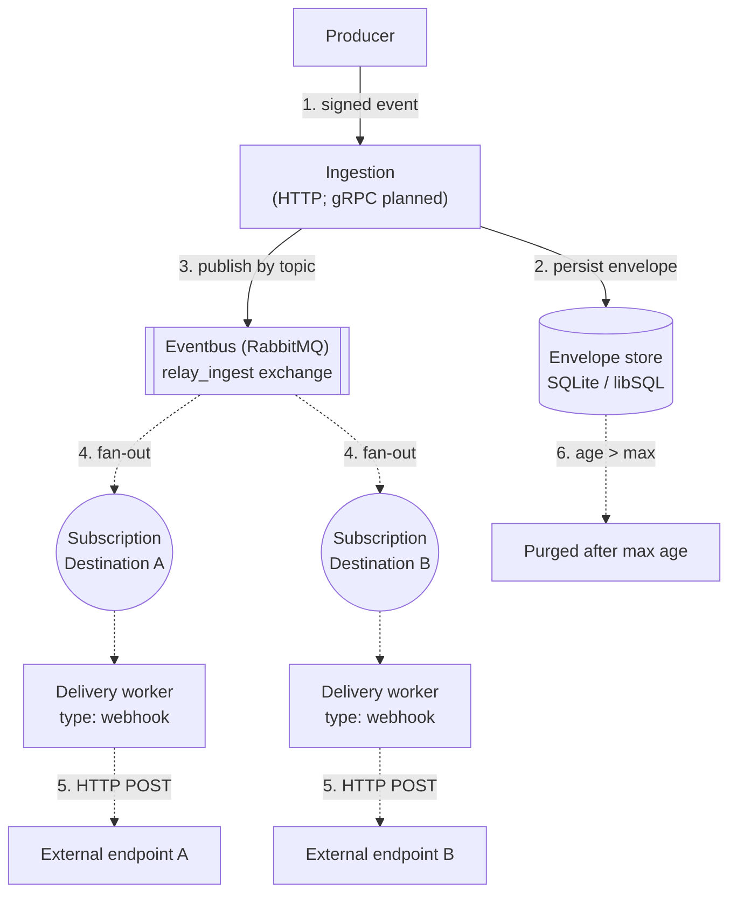

# Engineering docs

How Relay is built, for the people working on it. These docs give you a map
for reading the code and warn you about what it can't show. They don't replace
it: if you could learn something in a few minutes from the code, spec, migrations,
or tests, it isn't here. What the product does is in the
[product docs](../product/README.md).

## What goes where

| Folder                   | What it holds                                                  | Add a doc when                                                     |
| ------------------------ | -------------------------------------------------------------- | ------------------------------------------------------------------ |
| `architecture/systems/`  | How something overarching works, such as authentication        | Several features or repositories rely on it                        |
| `architecture/features/` | How one feature works, and what to know before changing it     | The feature needs a map, or has tradeoffs, gotchas, or gaps to record |
| `providers/`             | A third-party service: how it's set up and how it behaves      | It needs setup outside this repository, or was checked by hand     |
| `runbooks/`              | What to do when something has to be fixed by hand              | A recovery can only be done by hand                                |

A folder appears once it has a doc in it. Most features have no doc, and that's
expected. A feature gets one only when there's something the code can't say.

## What you'll find in a doc

| Section    | What it tells you                                               |
| ---------- | --------------------------------------------------------------- |
| Tradeoffs  | What we chose, what it costs, and why that's worth it           |
| Gotchas    | What's correct but will surprise whoever changes it             |
| Known gaps | What isn't done yet, and what closes it                         |

A gap we intend to close is a known gap, and says what it's waiting on. Something
we've decided to live with for good is a tradeoff.

## Deciding where something goes

- **Several features would trip over it**: a system doc.
- **Only someone working on one feature would**: that feature's doc. If a second
  feature comes to need it, move it to a system doc and link to it.
- **Something missing that someone using the product would notice**: the product
  docs, under its capability's Known gaps. If only someone working on the code
  would notice, it goes here. It's never in both.
- **Something true of one function**: a code comment.
- **A business rule**: the product docs.
- **An environment variable**: the repository's README.
- **Something true only while a change rolls out**, such as deploy order: its pull
  request.

These docs never hold real secrets, accounts, or anyone's personal details.

## Keeping them current

A doc changes along with whatever it describes. When a gap is closed, delete it:
the history is in git.

## The system at a glance

Relay is one Go binary. `relay serve` runs an HTTP API over a SQLite or libSQL
database, a separate encrypted secret store, and a RabbitMQ broker it uses as
its eventbus. The file-by-file layout is in
[CONTRIBUTING.md](../../CONTRIBUTING.md#project-layout).

An event moves through it like this. Steps 1 to 3 are built; the rest is the
target shape.

- [Eventbus](architecture/systems/eventbus.md): how envelopes are published for
  routing, and why routing lives in the broker rather than in Relay.
- [Secrets](architecture/systems/secrets.md): how source keys and destination
  signing secrets are stored and encrypted.
